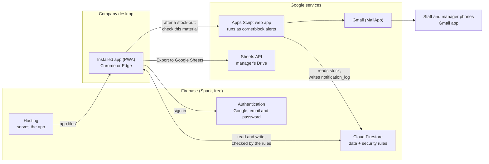

# Capstone notes

**Cloud-Based Materials Inventory Management System with Email Notification for Cornerblock Trading Inc.**

Material for rewriting Chapters 3 and 4 after the move from the LAN version (PHP and MySQL on XAMPP) to the cloud version (Firebase on the free Spark plan). Everything here describes the system as deployed at https://cornerblock-inventory.web.app

1. [Architecture](#1-architecture)
2. [Collections and fields](#2-collections-and-fields)
3. [Roles and permissions](#3-roles-and-permissions)
4. [The audit trail](#4-the-audit-trail)
5. [Offline entry and sync](#5-offline-entry-and-sync)
6. [What changed from the LAN version](#6-what-changed-from-the-lan-version)
7. [Screenshots to retake](#7-screenshots-to-retake)

## 1. Architecture

**The desktop app.** A single-page app built with Vite, plain JavaScript modules and Bootstrap 5, keeping the LAN version's stylesheet unchanged. It is installed from Chrome or Edge as its own window (a Progressive Web App) and keeps a copy of its own files, so it opens without a connection. It is designed for the desktop only; phones are where the alert emails are read.

**Firebase.** Authentication handles sign-in with Google or email and password. Firestore holds all the data. Its **security rules** (`firestore.rules`) are the real access control: they run on Google's servers and decide every read and write, so hiding a button in the interface is only tidiness. Hosting serves the app over HTTPS.

**The Apps Script.** Sending email needs a credential, and anything in the browser is visible to everyone using it. So email is sent by a separate Google Apps Script, owned by the alert account and running as that account, which needs no password. The app calls it after every stock-out with the material's id and the user's sign-in token. The script checks the token with Google, reads the material's real stock from Firestore itself, decides which alerts are due, sends them, and records each in `notification_log`. It ignores any figures in the request, so a tampered browser cannot fake or suppress an alert.

**Google Sheets.** A manager can export the filtered movement history, or any of the four reports, to a new spreadsheet in their own Drive. The Drive permission (`drive.file`) is asked for only at that moment, and only lets the system see files it created.

**Cost.** Nothing is paid for. The free limits and what happens when one is reached are in the README.

## 2. Collections and fields

These replace the ERD. Firestore is a document database: each collection holds documents, and the id of a document is shown as `{id}`. There are no foreign keys; where one document refers to another it stores the other's id, and often a copy of its name, so a record still reads correctly if the other is later archived or deleted.

Every document that the app writes also carries **`lastAuditId`**, the id of the audit entry explaining its current state (see section 4).

### `users/{uid}`

One per person, created when they first sign in. `{uid}` is their Firebase Authentication id.

| Field | Type | Notes |
|---|---|---|
| `name` | string | |
| `email` | string | |
| `photoURL` | string or null | From Google |
| `provider` | string | `password` or `google.com` |
| `role` | string | `production_staff`, `general_manager` or `webmaster` |
| `status` | string | `pending`, `active` or `disabled` |
| `emailVerified` | boolean | Kept in step with Google; may only be set to what the user's sign-in token says |
| `createdAt`, `lastLoginAt` | timestamp | |
| `approvedBy`, `approvedAt` | uid, timestamp | Who approved or re-enabled the account |

### `materials/{id}`

The catalog, readable by everyone signed in and approved.

| Field | Type | Notes |
|---|---|---|
| `name`, `category`, `size`, `unit`, `notes` | string | Category is free text, shown in Title Case |
| `stockQuantity` | integer, 0 or more | Changed only by a stock movement |
| `minThreshold` | integer | Reorder level. Staff may add materials but only with 0 here |
| `isArchived` | boolean | Nothing is deleted; archiving hides it |
| `lastMovementId` | id | The movement that last changed the stock |
| `createdAt`, `createdBy`, `updatedAt`, `updatedBy` | | |

### `material_costs/{materialId}`

Cost and supplier, split from the material so production staff cannot read them at all. Same id as its material.

| Field | Type |
|---|---|
| `costPerUnit` | number or null |
| `supplierId`, `supplierName` | id and string, or null |

### `suppliers/{id}`

Managers only.

| Field | Type |
|---|---|
| `name`, `viberContact`, `notes` | string |
| `isArchived` | boolean |
| `createdAt`, `createdBy`, `updatedAt`, `updatedBy` | |

### `stock_movements/{id}`

Every stock-in, stock-out and adjustment. Never changed or deleted once written.

| Field | Type | Notes |
|---|---|---|
| `materialId`, `materialName` | id, string | The name is copied so the history reads correctly after a rename or archive |
| `type` | string | `in`, `out` or `adjust` |
| `quantity` | integer, more than 0 | The size of the change |
| `difference` | integer | Adjustments only: counted minus recorded |
| `beforeQty`, `afterQty` | integer | Stock either side, as shown on screen when it was entered (exact for adjustments) |
| `movementDate` | `YYYY-MM-DD` | Set to today by the app; cannot be backdated |
| `reason` | string | From a fixed list per type |
| `project` | string | **Stock-outs:** the job the materials went to. Required, 2 to 100 characters, unless the reason is Damaged |
| `projectKey` | string | `project` lowercased, trimmed, single spaces; what the Project filter searches. The rules check it matches |
| `reference` | string | **Stock-ins:** a PO or delivery number. Older stock-outs kept their project here |
| `notes` | string | Required (5 characters or more) when the reason is Other |
| `receiptId` | id or null | **Every new stock-in must have one**, written in the same batch |
| `loggedBy`, `loggedByName` | uid, string | Who entered it, with their name saved |
| `createdAt` | timestamp | Server time |
| `source` | string | `lan-migration` on movements copied from the LAN version |

### `receipts/{id}`

The delivery receipt photo for a stock-in, compressed in the browser to 300 KB or less and stored in the document itself (the free plan has no file storage).

| Field | Type |
|---|---|
| `movementId` | id of its stock-in |
| `mimeType`, `dataBase64`, `sizeBytes` | the image |
| `uploadedBy`, `createdAt` | |

### `audit_logs/{id}`

The audit trail. See section 4.

| Field | Type | Notes |
|---|---|---|
| `action` | string | For example `stock.out`, `material.update`, `user.approve`, `user.delete`, `movements.export`, `reports.export` |
| `entity`, `entityId` | string, id | What was changed |
| `materialId` | id or null | The material concerned, so a material's whole history can be found |
| `actorUid`, `actorEmail`, `actorName`, `actorRole` | | Who did it, copied at the time |
| `before`, `after` | map or null | Only the fields that changed |
| `summary` | string | One readable sentence |
| `timestamp` | timestamp | Server time; the rules reject any other |
| `appVersion` | string | |

### `notification_log/{id}`

Written only by the Apps Script; no browser can write here.

| Field | Type |
|---|---|
| `materialId`, `triggerType` (`low-stock` or `stock-out`), `channel` (`email`) | |
| `recipientEmail`, `status` (`sent` or `failed`), `timestamp` | |

## 3. Roles and permissions

Enforced in `firestore.rules` and mirrored in the interface. The rules tests prove each line.

| Action | Staff | Manager | Webmaster |
|---|:---:|:---:|:---:|
| Log stock in (with receipt photo) and stock out (with project) | ✓ | ✓ | ✓ |
| View the catalog and movement history | ✓ | ✓ | ✓ |
| Add materials (staff: threshold 0) | ✓ | ✓ | ✓ |
| Edit and archive materials; manage suppliers | | ✓ | ✓ |
| See cost and supplier | | ✓ | ✓ |
| Adjust stock to a counted figure (reason required, online only) | | ✓ | ✓ |
| Dashboard, reports, reorder checklist | | ✓ | ✓ |
| Export Movement History and the reports to Google Sheets | | ✓ | ✓ |
| Audit trail and CSV download | | ✓ | ✓ |
| Approve, reject, disable, re-enable accounts | | ✓ | ✓ |
| Demote a manager to staff | | ✓ | ✓ |
| Delete a disabled account | | ✓ | ✓ |
| Promote staff to manager | | | ✓ |

Applies to every role:

- **Pending** accounts can read only their own `users` document and nothing else.
- Nobody changes their own role or status, or deletes their own account.
- Nobody changes or deletes the webmaster's account. The webmaster is identified by verified email address, so the system cannot be locked out even if the `users` collection were damaged.
- Roles change only on **active** accounts. A **disabled** account can only be re-enabled or deleted.
- Only **disabled** accounts can be deleted. Deleting removes the `users` document, not the person's history.

## 4. The audit trail

**Every write is recorded, and the server makes sure of it.** The rules refuse any change to data unless the same batch also creates a brand new `audit_logs` entry, and the changed document names that entry in its `lastAuditId`. The check (`audited()` in the rules) requires the entry to exist after the batch and not before, so an entry cannot be left out and cannot be reused for a second change.

**Entries can never be changed or deleted,** by anyone, the webmaster included.

**How the app writes:** `auditedWrite()` in `src/lib/audit.js` picks the entry's id first, stamps it on every document being changed, and commits the data and the entry together in one batch. Either everything lands or nothing does.

**Deletes** are the one case where the document cannot carry `lastAuditId`, because it is gone afterwards. The entry for deleting an account is therefore named after the account and its current `lastAuditId` (`user-delete-{uid}-{lastAuditId}`), which the rules can work out from the document before it goes.

**What an entry holds:** who (name, email and role at the time), what (action and record), the fields that changed before and after, a readable summary, and the server's timestamp.

**Reading it:** the Audit Trail page (managers) filters by date range, user, action, category and material, and downloads the filtered entries as a CSV file. Exports are themselves recorded (`audit.export`).

**The Google Sheets export lives on Movement History,** which is the record a manager works from in a spreadsheet. It takes the filters on screen, includes every matching movement rather than one page, adds Unit cost and Value (at current cost) for managers, and is recorded as `movements.export` with the filters and number of rows.

**Each report exports too,** from an Export to Google Sheets button next to Print. The spreadsheet holds what the report shows with its filters applied, numbers as numbers so they can be summed, and a Total row on the Inventory, Stock Movement and Inventory Value reports; the value report adds a second tab, By Category. The Stock Movement export has the same columns as the Movement History one, costs included, and its Total row gives the quantity and value of what is listed, so a report searched down to one project shows what that project used. Value is at the current unit cost, since the system keeps no price history. One routine in `pages/reports.js` does this for all four, and each export is recorded as `reports.export` with the report's name, the filters and the number of rows.

## 5. Offline entry and sync

The office connection can drop. Stock In and Stock Out still work:

1. Firestore keeps a local copy of the data on the computer, so pages still show the catalog.
2. A movement entered offline is saved on the computer and the page says so: "saved on this computer and waiting to reach the server".
3. When the connection returns, Firestore sends it, with its audit entry, in the same batch.

**Why offline entries still add up.** A stock-in or stock-out changes the total with `increment()`, a change rather than a figure. Two withdrawals of 5, both entered against a total of 18 on different computers, correctly leave 8. The rules check the change against the live total at the moment it lands.

**Nothing is queued that would be refused later.** Before an entry is saved, the form checks everything the rules will check: a receipt photo on a stock-in, a project on a stock-out (unless Damaged), notes when the reason is Other. Confirm stays switched off until they are there. The one refusal left is a stock-out that would take the total below zero because something else was withdrawn first. If that happens, a red bar on every page names the entry so it can be entered again.

**Adjustments are online only,** because an adjustment overrides the total with a counted figure, and that only makes sense against the figure the server holds right now.

**The installed app's files** are kept by its service worker, so the window opens even with no connection. Online, it never shows an old file after a deploy: pages and fixed-name files come from the network first, and the built scripts and stylesheets are named after their contents, so a changed file has a new address the old copy cannot answer for.

## 6. What changed from the LAN version

| LAN version | Cloud version |
|---|---|
| PHP and MySQL on XAMPP, one office PC | Firebase, reachable from any desktop with internet |
| Manager typed each employee's password | People register themselves; a manager approves them |
| Roles checked in PHP controllers | Roles enforced by security rules on Google's servers |
| Gmail App Password in a config file | Apps Script sends as its own account; no password anywhere |
| No record of edits | Every change recorded, and the record cannot be altered |
| Cost hidden from staff by the page | Cost and supplier in a separate collection the server will not give staff |
| No receipt requirement | A receipt photo on every stock-in |
| Project optional on a stock-out | Project required on stock-outs (except Damaged), with suggestions and a filter |
| One stock form, a 52-item dropdown | A searchable material picker |
| No offline use | Entries made offline sync when the connection returns |

**Known legacy data.** `legacy-php/database/seed.sql` (and `database/seed.sql` in older commits) contains bcrypt password hashes for the LAN version's demo accounts. They are kept as part of the original submission and were left in the repository history rather than rewriting it. The cloud version does not use them, and has no password of its own anywhere.

## 7. Screenshots to retake

Take these on the company desktop, in the installed app, signed in as the role given. Use real data where possible.

**Signing in and accounts**

1. Login page, showing the full system name.
2. Request sent screen after registering with email and password, with the verification line.
3. The same screen after the email is verified (the "Email verified" check).
4. No access screen for a disabled account.
5. Users page, Pending tab, with the Unverified badge (manager).
6. The "hasn't verified their email yet. Approve anyway?" confirmation.
7. Users page, Disabled tab, showing Re-enable and Delete.
8. The Delete confirmation with the red Delete button.

**Stock**

9. Materials catalog as a manager (cost and supplier columns) and as staff (without them).
10. Stock In, with the material picker open and filtered by a typed name.
11. Stock In with Confirm switched off and "Attach a photo of the delivery receipt."
12. Stock In after attaching a receipt (the "reduced to" line).
13. Stock Out with reason Project Usage (Project required) and with Damaged (Project optional).
14. Stock Out with reason Other and the notes message.
15. Adjust Stock modal (manager).
16. The offline notice after a stock-out entered with the network off.

**History, reports and audit**

17. Movement History with Category, Project and a date preset applied, showing the heading ("42 movements from ...") and the Project column.
18. A movement row showing "Stock 4 → 9" and a receipt View.
19. Movement History, Export to Google Sheets result, and the spreadsheet open in Sheets.
20. Dashboard (manager).
21. Each report: Inventory, Low Stock, Stock Movement, Inventory Value, with a category filter, and the Inventory Value export open in Sheets showing both tabs.
22. Reorder Checklist, on screen and printed.
23. Audit Trail with filters, and an entry's detail showing before and after.
24. Settings, with Email Alerts showing Working.

**Email and install**

25. Low-stock alert email in the Gmail app on a phone.
26. Stock-out alert email in the Gmail app on a phone.
27. Reorder checklist email in the Gmail app on a phone.
28. The install prompt in Chrome or Edge, and the app open in its own window.
